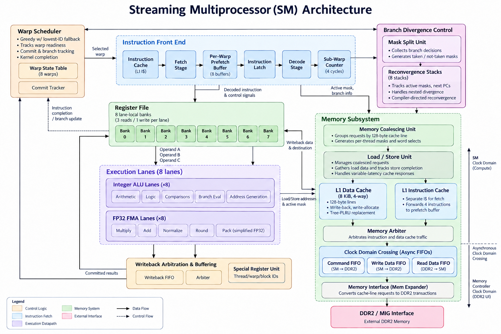

# GPGPU Streaming Multiprocessor (SM)

A SystemVerilog implementation of the microarchitecture of a single **GPU Streaming Multiprocessor**, featuring a lockstep SIMT execution model, warp scheduling, latency hiding, branch divergence, a pipelined FP32 multiply-add (FMA) unit, memory coalescing, and a cache hierarchy connected to a DDR2-style memory interface. It also focuses on coordinating many execution units, handling timing, stalling, and a variable-latency memory system.

## Architecture



## Overview

| Feature | Design |
|---|---|
| Architecture | Single-SM, SIMT |
| Resident warps | Up to 8 warps (32 threads each) |
| Physical execution lanes | 8 (each warp issues over 4 sub-warp cycles) |
| Register file | 32 × 32-bit per thread |
| Arithmetic | 32-bit integer ALU and 4-stage simplified FP32 FMA |
| Warp scheduling | Greedy scheduling with lowest-ID fallback |
| Divergence | Per-warp reconvergence stack (8 entries) |
| L1 caches | 8 KiB I$ & 8 KiB D$, 4-way set-associative blocking cache |
| Memory transactions | 128 bits per memory UI clock cycle (8 beats for 128 B line) |
| Clock domains | SM fabric (100 MHz), MIG UI clock (81.25 MHz) |
| Target platform | Digilent Nexys A7-100T |

## How It Works

### SIMT Execution & Warp Scheduling

- **32 threads per warp, 8 physical lanes:** each instruction executes over four 8-thread sub-warps.
- **Up to 8 resident warps:** the scheduler stays on a ready warp when possible, otherwise selects another ready warp using fixed-priority fallback.
- **Hazard handling:** Every warp instruction marks its own warp not-ready until its results commit. Latency hiding is done via switch to another warp. `commit_tracker` tracks completion across all four sub-warps.
- **Backpressure:** When a writeback buffer is full, execution units hold in-flight instructions' results and `sub_warp_counter` pauses to stop issuing new instructions.
- **Prefetching:** per-warp instruction buffers reduce delays when switching warps.

### Control

- `warp_scheduler` - Selects ready warps for execution, greedily staying on the current warp if it is ready and falling back to the lowest ready warp ID. The next warp is staged one instruction ahead, and a warp that is already being staged cannot be picked again until its instruction completes. It also tracks stalls, instruction completion, and kernel termination.

- `mask_split_unit` - Collects branch decisions across four sub-warps and generates taken/not-taken thread masks.

- `recon_stack` - Maintains a per-warp SIMT stack storing the current PCs, active-thread masks, and reconvergence PCs to handle divergent branches.
    - When pushing branch decisions, the parent entry is preserved while branches are pushed given that they have at least one active thread.
    - Popping occurs when the fetch PC reaches the top entry's reconvergence PC.

### Front end

- `fetch_stage` - Fetches instructions from the L1 instruction cache for the selected warp.

- `prefetch_buffer` - Each time an instruction request goes out, 4 instructions are stored in the buffer to avoid sending a request to the cache/memory for each instruction.
    - It never fills past the reconvergence PC or cache-line boundary
    - Once a branch or DONE is consumed, remaining entries are marked invalid

- `instruction_latch` - Holds the current instruction across four sub-warp cycles and generates register-file read addresses so that the register file can return the source register data at the same cycle the decode stage breaks down the instruction.

- `decode_stage` - Decodes instructions and generates control signals, valid signals for each execution unit, register destination addresses, and active-lane masks.

- `sub_warp_counter` - Tracks the four execution cycles per warp instruction and pauses when the writeback arbiter stalls or when the `fetch_stage` doesn't have a valid fetch instruction for the next_warp.

### Execution & Writeback

- `int_alu` $\times8$ - Performs arithmetic and logic operations, comparisons, branch conditions, and load/store address generation.

- `fp32_fma` $\times8$ - Implements a 4-stage pipelined FP32 multiply-add (`src1 * src2 + src3`) on IEEE-754 single-precision values. It is a simplified, not strictly fused, FMA:
    - The 48-bit product is truncated to a 24-bit mantissa before alignment and addition, so the result can differ from a true single-rounding FMA in the last bit(s)
    - The final sum is rounded to nearest-even using guard/round/sticky bits
    - Overflow saturates to infinity and underflow flushes to zero; NaN, infinity, and subnormal inputs are not handled

- `writeback_arbiter` + `writeback_fifo` - Arbitrates between ALU, FMA, LSU, and special_register results to access the register bank while buffering unchosen, but valid, results
    - FIFO supports 16 entries per lane
    - Buffered results drain first since they come from older instructions
    - Fixed priority when 2 or more instructions finish executing at the same time (LSU > FMA > ALU > special-reg)

- `commit_tracker` - Tracks register-file commits across all four sub-warps and signals instruction completion to the warp scheduler.

### Register File

- `reg_file` $\times8$ banks (one for each lane) with 3 copies of the bank to support 3 synchronous read ports and one write port.
    - Address = `{warp_id[2:0], thread_slot[1:0], reg_num[4:0]}`

- `special_reg_unit` $\times8$ - Generates thread, warp, and block IDs for special-register instructions.

### Memory

- `memory_coalescing_unit` - Groups active threads accessing the same **128-byte cache line** into one transaction, carrying thread masks and word selections for responses.

- `load_store_unit` - Registers outstanding request metadata, accumulates returned load data and forwards it to the `writeback_arbiter`. Since a store never writes a register, it signals `store_done` on store completion so the `warp_scheduler` can set the warp ready again.

- `l1_cache` - Implements an 8 KiB, 4-way set-associative cache with write-back, write-allocate, and tree-PLRU replacement.

- `l1_icache` - Adapts data cache to be read only and parses cache line for the next four instructions to be given to the `prefetch_buffer`.

- `mem_arbiter` - Arbitrates between the instruction and data cache requests to the shared memory interface choosing the cache that did not last have access to the memory.

- `cdc_fifo` - Asynchronous FIFO with Gray-coded pointers and two-flop synchronizers between the SM and memory-controller clocks. There are **three instances** in `sm_top`:
    - `cmd_fifo` — Transfers read/write memory commands from the SM clock domain to the DDR2 memory-controller clock domain.
    - `wr_fifo` — Transfers 128-bit write-data bursts from the SM clock domain to the DDR2 memory controller.
    - `rd_fifo` — Transfers 128-bit read-data bursts and end-of-transaction information from the DDR2 memory controller back to the SM clock domain.

- `mem_expander` - Translates cache-line requests into 8 MIG-compatible DDR2 memory transactions.

## Instruction Set

Custom **32-bit, MIPS-inspired ISA** with GPU-specific branch and thread-identity operations.

| Format | Instructions | [31:26] | [25:21] | [20:16] | [15:0] |
|---|---|---|---|---|---|
| FMA | `FMA` | opcode | src1 | src2 | src3 [15:11], dst [10:6], unused [5:0] |
| R-type (int ALU) | `ADD`, `SUB`, `MUL`, `AND`, `OR`, `SLT` | opcode | src1 | src2 | dst [15:11], unused [10:0] |
| I-type (load/store/imm) | `ADDI`, `SUBI`, `LUI`, `ANDI`, `ORI`, `SLTI`, `LOAD`, `STORE` | opcode | base reg (src1) | dst (src2 for `STORE`) | immediate [15:0] |
| Branch | `BEQ`, `BNE`, `BLT`, `BGE` | opcode | src1 | src2 | target_offset [15:8], reconv_offset [7:0] |
| Special | `MOV_TID`, `MOV_WID`, `MOV_BID` | opcode | dst | unused | unused |
| Control | `NOP`, `DONE` | opcode | unused | unused | unused |

- The opcode is a 3-bit format field `[31:29]` followed by a 3-bit function field `[28:26]`; `DONE` is `6'b111111`.
- Source registers sit at fixed fields across instruction types.
- Branch instructions carry **target PC and reconvergence PC offsets**.
- Memory accesses are **32-bit word-aligned**.

### Kernel launch and completion

- To launch a kernel, the `kernel_start` signal pulses and `num_warps` warps are set to ready while remaining/unused warp slots are permanently marked not-ready and finished.

- Once all warps are completed, `warps_done` is asserted, triggering the data cache to flush its dirty lines to memory.

- Once the flush is complete (`flush_done` goes high), the kernel is marked complete via `kernel_done`.

## Verification

- **Unit tests:** Each major module has its own testbench to verify its functionality in isolation.
- **Subsystem tests:** Front-end and memory integration, including cache misses and clock-domain crossing, to verify that the components of a subsystem work together.
- **Full-SM test:** [`final_integration_tb.sv`](testbenches/integration/final_integration_tb.sv) instantiates `sm_top` with a behavioral MIG/DDR2 memory model and runs 10 progressively larger kernels: arithmetic, divergence, FMA, special registers, loads/stores, coalescing, multi-warp workloads, and a final full-system kernel.

### Example: full-system kernel

The final test runs one kernel on **all 8 warps**. It combines three levels of nested divergence, integer, special-register and FMA instructions, and loads and stores. Some addresses map to the same cache set and force evictions in the 4-way D$ and dirty writebacks to DDR2.

```text
MOV_WID R1          # R1 = w
MOV_TID R2          # R2 = t
ADD R3, R1, R2      # R3 = w + t
LOAD R4, A

if (t % 2 == 0) {                   # outer divergence
    MUL R6,R3,R3                    # (w+t)^2
    STORE R6, A

    if (t % 4 == 0) {               # middle divergence
        STORE R6, B
        STORE R6, C
        STORE R6, D

        if (t % 8 == 0) {           # inner divergence
            FMA R16,R13,R14,R15
            STORE R16, E            # evicts a line from set
            LOAD  R17, A
            STORE R17, F
        }

        ADDI R18,R6,1
    } else {                        # t % 4 == 2
        MUL R6,R2,R3                # t*(w+t)
        STORE R6,B
        LOAD R17,B
    }

    LOAD R19,A
    ADD R20, R19, R3
}

LOAD R21, A
ADD R22,R21,R3
STORE R22, F
DONE
```

The testbench monitors every register-file write: warp, thread, register, data value, and how many times each was written. It checks all of them against a reference model. Any missing or duplicate writeback, wrong value, or write from the wrong divergence path fails the test.

The kernel completes in **4276 cycles** (including the final D$ flush) and passes with all **2,624** expected register writes matching.

## Repository Structure

```text
docs/              # Architecture diagram

src/
├── control/       # Warp scheduling, branch mask split, and reconvergence stack
├── execution/     # Integer ALU/FP32 FMA execution units and writeback
├── front_end/     # Fetch stage, prefetch buffer, decode stage, sub-warp control
├── memory/        # Coalescer, LSU, caches, CDC FIFOs, DDR2 interface
├── registers/     # Register file and special registers
└── sm_top.sv      # Integrated streaming multiprocessor

testbenches/       # Unit, subsystem, and full-SM tests
├── control/
├── execution/
├── front_end/
├── integration/   # Subsystem & full-SM tests
├── memory/
└── registers/
```

## Building and Simulation

Requires Verilator 5.x (`--timing` support). From the repository root:

```bash
verilator --binary --sv --timing --trace --Wall --Wno-fatal \
    -Wno-ASCRANGE \
    -Wno-PINCONNECTEMPTY \
    -Wno-EOFNEWLINE \
    -Wno-UNUSEDSIGNAL \
    -Wno-WIDTHEXPAND \
    -Wno-WIDTHTRUNC \
    --top-module final_integration_tb \
    $(find src -type f -name "*.sv") \
    testbenches/integration/final_integration_tb.sv \
    && ./obj_dir/Vfinal_integration_tb
```

Each test prints its cycle count followed by `PASSED`; any failure stops the simulation with `$fatal`.

## Future Work

This is a single-SM RTL project that may be expanded to include the following:

- [ ] Add shared memory to allow communication between threads
- [ ] Implement a scoreboard to only mark a warp not ready on a true dependency
- [ ] Include block-level barrier synchronization between threads/warps
- [ ] Multi-SM support with cache coherence
- [ ] Make the FMA truly fused (keep the full 48-bit product) and add full IEEE-754 special-case and subnormal support
- [ ] Develop a software toolchain (e.g. a compiler)

## Current Status & Next Steps

- [x] Complete full `sm_top` integration tests for arithmetic, memory, divergence, and multi-warp workloads
- [ ] Run FPGA synthesis, timing analysis, and hardware DDR2 validation
- [ ] Measure performance & resource utilization on hardware
